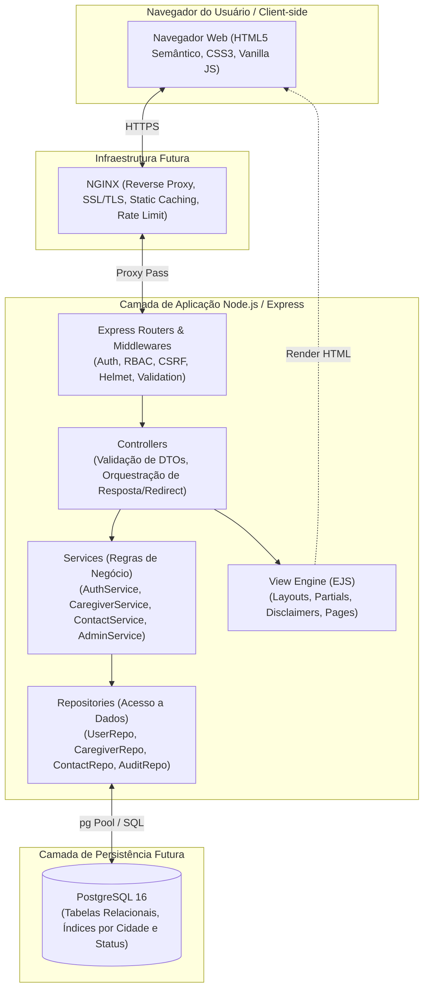
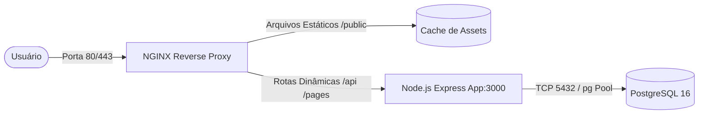

# Arquitetura Técnica — CuidaPerto

**Versão:** 1.0  
**Status:** Aprovada pelo Usuário  
**Stack Principal:** Node.js LTS, Express, EJS, Vanilla JS, HTML5/CSS3 (futuro: PostgreSQL, Docker Compose, NGINX)  

---

## 1. Visão Geral e Princípios Arquiteturais

A arquitetura do **CuidaPerto** foi projetada para garantir **simplicidade inicial**, **alta testabilidade**, **baixo acoplamento** e **aderência estrita aos requisitos de privacidade e acessibilidade**, preparando o sistema para uma transição suave para PostgreSQL e orquestração via contêineres sem necessidade de refatoração do núcleo de negócio.

### Princípios Norteadores:
1. **Separação de Responsabilidades (SoC):** Divisão estrita em 4 camadas: Apresentação (Views/Assets), Entrada/Controle (Rotas/Controllers), Regras de Negócio (Services) e Acesso a Dados (Repositories).
2. **Independência de Framework no Domínio:** Os `services` não acessam objetos HTTP (`req`, `res`) nem comandos diretos de banco de dados, facilitando testes unitários determinísticos e rápidos.
3. **Repository Pattern:** O acesso aos dados é abstraído por contratos (interfaces). No início, podemos utilizar repositórios em memória ou adaptadores leves para testes e desenvolvimento ágil, conectando ao PostgreSQL via `pg` pool sem alterar as regras de negócio.
4. **Segurança por Padrão (Security by Design):** Proteção CSRF, rate limiting, sanitização XSS, cookies de sessão com atributos `HttpOnly`, `SameSite=Lax/Strict` e `Secure`.
5. **Acessibilidade como Cidadão de Primeira Classe:** Templates EJS estruturados com HTML5 semântico, landmarks ARIA e contraste compatível com WCAG 2.1 Nível AA.

---

## 2. Visão em Camadas (Layered Architecture)



---

## 3. Estrutura de Diretórios Proposta

```text
cuidador/
├── AGENTS.md                          # Diretrizes do agente de engenharia
├── README.md                          # Documentação geral de inicialização
├── package.json                       # Metadados e dependências (a instalar pós-aprovação)
├── .env.example                       # Modelo de variáveis de ambiente
├── .gitignore                         # Arquivos ignorados pelo Git
│
├── docs/                              # Documentação técnica e de negócio
│   ├── requisitos.md                  # Especificação oficial de requisitos (aprovada)
│   ├── arquitetura.md                 # Arquitetura aprovada e decisões de design
│   └── modelagem-dados.md             # Dicionário de dados e DER conceitual
│
├── docker/                            # Configurações de contêineres (planejamento futuro)
│   ├── Dockerfile                     # Multi-stage build com usuário não-root
│   ├── docker-compose.yml             # Orquestração local (app + postgres + nginx)
│   └── nginx/
│       └── default.conf               # Configuração do proxy reverso, headers e cache
│
├── src/                               # Código-fonte da aplicação
│   ├── server.js                      # Ponto de entrada (inicialização de porta e shutdown gracioso)
│   ├── app.js                         # Configuração e montagem do Express (middlewares e rotas)
│   │
│   ├── config/                        # Configurações estáticas e variáveis de ambiente
│   │   ├── env.js                     # Validação e tipagem de variáveis do .env
│   │   ├── constants.js               # Enums (modalidades, perfis de usuário, status de moderação)
│   │   └── database.js                # Configuração do Pool PostgreSQL (futuro)
│   │
│   ├── routes/                        # Definição e agrupamento de rotas HTTP
│   │   ├── index.js                   # Agregador central de rotas
│   │   ├── public.routes.js           # Home, busca pública e perfis de cuidadores
│   │   ├── auth.routes.js             # Login, registro e logout de famílias e cuidadores
│   │   ├── caregiver.routes.js        # Painel do cuidador (edição de perfil e solicitações)
│   │   ├── family.routes.js           # Painel da família (solicitações enviadas)
│   │   └── admin.routes.js            # Painel administrativo de moderação e auditoria
│   │
│   ├── controllers/                   # Orquestração de requisição/resposta
│   │   ├── public.controller.js       # Render da home e busca de cuidadores
│   │   ├── auth.controller.js         # Processamento de credenciais e sessões
│   │   ├── caregiver.controller.js    # Salvar perfil, gerenciar solicitações recebidas
│   │   ├── contact.controller.js      # Envio de pedidos de contato pela família
│   │   └── admin.controller.js        # Aprovação/rejeição de perfis e logs
│   │
│   ├── services/                      # Regras de Negócio e Casos de Uso (Puro JS)
│   │   ├── auth.service.js            # Lógica de login, hash de senha e validações
│   │   ├── caregiver.service.js       # Regras de atualização de perfil e disponibilidade
│   │   ├── contact.service.js         # Regras de envio, aceite mútuo e bloqueio de contatos
│   │   ├── moderation.service.js      # Regras de moderação prévia e denúncias
│   │   └── audit.service.js           # Gravação de trilha de auditoria para ações de admin
│   │
│   ├── repositories/                  # Abstração de Acesso a Dados (Pattern Repository)
│   │   ├── interfaces/                # Contratos formais esperados pelos serviços
│   │   │   ├── user.repository.interface.js
│   │   │   ├── caregiver.repository.interface.js
│   │   │   └── contact.repository.interface.js
│   │   ├── in-memory/                 # Implementação mockada em memória (para testes unitários)
│   │   │   ├── memory-user.repository.js
│   │   │   └── memory-caregiver.repository.js
│   │   └── postgres/                  # Implementação real em SQL/PostgreSQL (futuro)
│   │       ├── pg-user.repository.js
│   │       ├── pg-caregiver.repository.js
│   │       └── pg-contact.repository.js
│   │
│   ├── middlewares/                   # Middlewares Express
│   │   ├── auth.middleware.js         # Checagem de autenticação (sessão válida)
│   │   ├── rbac.middleware.js         # Controle de acesso baseado em papéis (ROLE)
│   │   ├── csrf.middleware.js         # Validação de token anti-CSRF
│   │   ├── validation.middleware.js   # Validação de esquemas de entrada (sanitização de inputs)
│   │   ├── rate-limit.middleware.js   # Limitação de requisições em rotas sensíveis
│   │   └── error.middleware.js        # Tratamento centralizado de erros e páginas 404/500
│   │
│   ├── views/                         # Templates SSR (EJS)
│   │   ├── layouts/
│   │   │   └── main.ejs               # Layout base (HTML, <head>, nav, footer, scripts)
│   │   ├── partials/                  # Componentes reutilizáveis
│   │   │   ├── header.ejs             # Barra de navegação com estado de autenticação
│   │   │   ├── footer.ejs             # Rodapé com links de acessibilidade e LGPD
│   │   │   ├── flash-messages.ejs     # Mensagens de alerta de sucesso e erro
│   │   │   ├── disclaimer-box.ejs     # Aviso legal obrigatório de qualificação declarada
│   │   │   ├── caregiver-card.ejs     # Card de exibição do cuidador na busca
│   │   │   └── pagination.ejs         # Controles de navegação de páginas
│   │   └── pages/                     # Telas específicas
│   │       ├── home.ejs               # Página inicial com campo de busca por cidade
│   │       ├── search-results.ejs     # Lista de cuidadores filtrados
│   │       ├── caregiver-profile.ejs  # Perfil público do cuidador
│   │       ├── auth/
│   │       │   ├── login.ejs          # Formulário unificado de login
│   │       │   ├── register-family.ejs
│   │       │   └── register-caregiver.ejs
│   │       ├── caregiver/
│   │       │   ├── dashboard.ejs      # Gestão de solicitações
│   │       │   └── edit-profile.ejs   # Edição de dados e disponibilidade
│   │       ├── family/
│   │       │   └── requests.ejs       # Acompanhamento de solicitações enviadas
│   │       ├── admin/
│   │       │   ├── moderation.ejs     # Fila de perfis aguardando aprovação prévia
│   │       │   └── audit-logs.ejs     # Histórico de moderação
│   │       └── errors/
│   │           ├── 403.ejs            # Acesso negado
│   │           ├── 404.ejs            # Página não encontrada
│   │           └── 500.ejs            # Erro interno
│   │
│   ├── public/                        # Arquivos estáticos servidos diretamente
│   │   ├── css/
│   │   │   ├── main.css               # Estilos globais (variáveis, tipografia legível)
│   │   │   ├── accessibility.css      # Regras específicas de contraste e foco
│   │   │   └── components.css         # Cards, formulários, botões
│   │   ├── js/
│   │   │   ├── main.js                # Comportamentos globais (menu mobile, flash dismiss)
│   │   │   └── search-filters.js      # Interatividade leve no formulário de busca
│   │   └── img/                       # Ícones e ilustrações públicas
│   │
│   └── utils/                         # Utilitários e helpers
│       ├── password.util.js           # Funções de hash e verificação com Argon2id/bcrypt
│       ├── sanitizer.util.js          # Higienização contra XSS em textos livres
│       └── custom-errors.js           # Classes AppError, ValidationError, NotFoundError
│
└── tests/                             # Suíte de Testes Automatizados
    ├── setup.js                       # Configuração global de ambiente de teste
    ├── unit/                          # Testes unitários (rápidos, sem I/O de rede)
    │   ├── services/
    │   │   ├── auth.service.test.js
    │   │   ├── caregiver.service.test.js
    │   │   └── contact.service.test.js
    │   └── utils/
    │       └── password.util.test.js
    ├── integration/                   # Testes de integração (rotas Express + middlewares)
    │   ├── auth.routes.test.js
    │   ├── search.routes.test.js
    │   ├── caregiver.routes.test.js
    │   └── admin.routes.test.js
    └── e2e/                           # Testes End-to-End (fluxo no navegador)
        └── user-flows/
            ├── search-and-request-contact.e2e.test.js
            └── caregiver-profile-moderation.e2e.test.js
```

---

## 4. Autenticação e Controle de Acesso (RBAC)

### 4.1. Modelo de Sessão
- **Mecanismo:** Sessões HTTP via cookies (`express-session`).
- **Atributos do Cookie:**
  - `httpOnly: true` (impede leitura via JavaScript no cliente, mitigando roubo via XSS);
  - `secure: process.env.NODE_ENV === 'production'` (transmissão somente sob HTTPS);
  - `sameSite: 'lax'` (proteção contra ataques CSRF de primeiro nível);
  - `maxAge`: Sessão de 24 horas para usuários comuns e 2 horas para moderadores/admins.
- **Persistência de Sessão:** Inicia com `MemoryStore` para testes locais e migra para `connect-pg-simple` no PostgreSQL com Docker.

### 4.2. Papéis de Usuário (Roles)
Definimos 3 papéis fundamentais:
1. `ROLE_FAMILY` (Família): Pode buscar, ver perfis públicos, enviar solicitações de contato e gerenciar suas mensagens enviadas.
2. `ROLE_CAREGIVER` (Cuidador): Pode editar seu perfil profissional, definir valores e disponibilidades, e aceitar/recusar solicitações recebidas.
3. `ROLE_ADMIN` (Administrador / Moderador): Pode auditar perfis, aprovar/rejeitar alterações na moderação prévia e suspender contas com infrações.

### 4.3. Middlewares de Segurança
- `ensureAuthenticated`: Redireciona usuários não autenticados para `/login` preservando a URL de destino.
- `ensureRole(['ROLE_CAREGIVER'])`: Retorna `403 Forbidden` se o papel não for correspondente.

---

## 5. Estratégia de Testes Automatizados

A pirâmide de testes será estruturada em 3 níveis complementares:

| Nível | Ferramentas Recomendadas | Foco | Isolamento |
| :--- | :--- | :--- | :--- |
| **Unitários** | Test Runner Nativo (`node:test`) ou `Vitest` | Métodos de serviços, funções de hash, validadores de regras de negócio. | 100% isolado (Repositórios mockados em memória). |
| **Integração** | `supertest` + Test Runner | Rotas Express, pipeline de middlewares (CSRF, RBAC, Validação de entrada), renderização EJS e códigos HTTP. | Executa o app Express em memória com repositórios de teste. |
| **End-to-End (E2E)** | `Playwright` | Navegação real de ponta a ponta: busca por cidade -> login -> envio de contato -> aceite no painel do cuidador. | Sistema completo em execução local. |

---

## 6. Planejamento de Implantação Futura (Docker Compose & NGINX)



- **Container do Node.js:** Multi-stage build utilizando imagem oficial `node:lts-alpine`, executando com usuário `node` não-root para mitigar escalonamento de privilégios.
- **Container do PostgreSQL:** Imagem oficial `postgres:16-alpine`, dados persistidos em volume nomeado do Docker.
- **NGINX:**
  - Terminação SSL/TLS;
  - Compressão Gzip/Brotli;
  - Servir diretamente a pasta `public/` (CSS, JS, imagens), desonerando o Node.js;
  - Definição de limites de taxa (`limit_req_zone`) para proteção contra DDoS e brute force.

---

## 7. Análise de Riscos e Estratégias de Mitigação

1. **Risco de Vazamento de Dados Sensíveis de Saúde (LGPD):**
   - *Cenário:* Familiares preencherem diagnósticos detalhados ou laudos médicos de idosos no campo de observação da solicitação.
   - *Mitigação:* Alerta na UI ("Não inclua relatórios médicos ou diagnósticos"), limite curto de caracteres e validação no service rejeitando termos sensíveis predefinidos.
2. **Risco de Alegação de Certificação Indevida:**
   - *Cenário:* Cuidador afirmar ser enfermeiro ou especialista sem comprovação.
   - *Mitigação:* Componente obrigatório `disclaimer-box.ejs` em todos os perfis; Moderação Prévia mandatória (nenhum perfil entra no ar sem aprovação de moderador).
3. **Risco de Injeção de Código (XSS) em Perfis Públicos:**
   - *Cenário:* Cuidador mal-intencionado incluir tags `<script>` em sua biografia.
   - *Mitigação:* Sanitização rigorosa no backend antes de persistir (`sanitize-html` ou escape nativo do EJS com `<%= %>`, nunca `<%- %>` para dados de usuário).
4. **Risco de Acoplamento Prematuro de Banco de Dados:**
   - *Cenário:* Dificuldade de rodar testes rápidos sem instalar PostgreSQL previamente.
   - *Mitigação:* Padrão Repository com implementação inicial em memória para suítes de teste limpas e ágeis.
